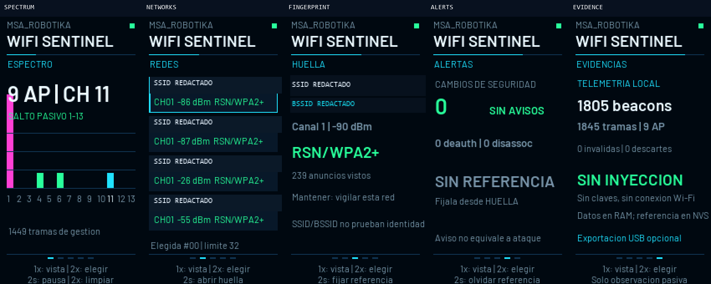

# MSA WiFi Sentinel



**A pocket-size, passive 2.4 GHz Wi-Fi observer for an ESP32 with a 170×320 screen.** It turns spare maker hardware into a transparent learning tool: channel activity, nearby access points, a local network fingerprint, cautious warnings, and evidence counters on the device itself.

The first physical build has been flashed and validated on an ideaspark ESP-WROOM-32 display board. It observed real beacon traffic across channels 1–13 while remaining disconnected from Wi-Fi. No packet-injection API is used.

## What it does

- Hops passively through 2.4 GHz channels 1–13.
- Reads beacon and probe-response management frames.
- Shows SSID, BSSID, channel, RSSI, advertised security, and observation count.
- Lets the owner store one selected network fingerprint in NVS after an explicit confirmation.
- Warns when the same SSID is observed with a different advertised security mode.
- Counts observed deauthentication and disassociation frames and flashes a red border briefly.
- Pauses/resumes monitoring and clears volatile observations from the physical BOOT button.
- Exposes optional newline-delimited JSON and framebuffer capture over USB serial.

It does **not** connect to a network, inspect payloads, store Wi-Fi passwords, attack clients, or prove that a warning is malicious. Deauthentication frames can be legitimate. Channel hopping samples one channel at a time, so frames can be missed. Classic ESP32 covers 2.4 GHz only.

## Five views

| View | Purpose |
|---|---|
| **ESPECTRO** | Activity by channel and current passive-hop status. |
| **REDES** | Up to 32 recently observed AP records. |
| **HUELLA** | Detail for the selected AP; prepares an owner-confirmed reference. |
| **ALERTAS** | Security-mode mismatch count plus deauth/disassoc observations. |
| **EVIDENCIAS** | Local counters, malformed/drop totals, and privacy mode. |

Public screenshots in `docs/screenshots/` are redacted. The firmware itself displays the locally observed identifiers because that is its diagnostic purpose.

## Controls

- **Short BOOT press:** next view.
- **Double press:** next AP in REDES/HUELLA; clear volatile observations in ESPECTRO.
- **Hold for 2 seconds:** pause/resume in ESPECTRO; open HUELLA from REDES; open the confirmation page from HUELLA; forget the stored reference from ALERTAS.
- **Hold again on the confirmation page:** save the currently selected network fingerprint. Only do this for a network you own or administer.

After 60 seconds without manual input, the dashboard resumes automatic rotation.

## Supported first build

- ideaspark ESP-WROOM-32 display board
- ESP32-D0WD / 4 MiB flash
- ST7789 170×320 panel
- pins: MOSI 23, SCLK 18, CS 15, DC 2, RST 4, backlight 32, BOOT 0

Boards sold under similar names may use different display geometry, inversion, or pins. Verify the schematic before flashing.

## Install a release binary

1. Download the release ZIP and verify `SHA256SUMS.txt`.
2. Install Python 3 and `pip install -r tools/requirements.txt`.
3. Put the ESP32 in its normal serial bootloader mode if your board does not reset automatically.
4. Flash without erasing the whole chip:

```text
python -m esptool --port COM4 write-flash \
  0x1000 bin/bootloader.bin \
  0x8000 bin/partitions.bin \
  0x10000 bin/firmware.bin
```

Replace `COM4` with your port. Make a full backup of your original 4 MiB flash first. Do not write eFuses.

The release also includes a guarded installer which verifies every binary, checks the chip family, and requires an explicit backup acknowledgement:

```text
python tools/flash.py --port COM4 --confirm-backup-made
```

## Build from source

PlatformIO Core is the easiest reproducible route:

```text
pio run -d firmware
```

The project pins the Espressif32 PlatformIO release in `firmware/platformio.ini`. Build outputs appear under `firmware/.pio/build/sentinel/`.

## Optional USB client

The display works independently. The Python client is for inspection and screenshots:

```text
python -m pip install -r tools/requirements.txt
python tools/device.py --port COM4 status
python tools/device.py --port COM4 aps
python tools/device.py --port COM4 capture capture.png
```

Creating a reference from USB requires the explicit flag:

```text
python tools/device.py --port COM4 baseline --confirm-owned-network
```

The client checks the firmware identity and can also pin the expected device MAC with `--mac`.

## Validation

See [VALIDATION.md](VALIDATION.md) for the measured on-device result. The source-policy test also fails if a Wi-Fi transmit/injection API is introduced.

## Contributing

Good first contributions include additional **receive-only** parsers, board profiles, translations, sanitized test captures, accessible color themes, and documentation. Features that transmit forged Wi-Fi frames are outside this project’s scope.

## License

MIT for the original application code. Third-party licenses and notices are included in the repository.

---

### Resumen en español

MSA WiFi Sentinel es un observador Wi-Fi pasivo y educativo para ESP32 con pantalla. Recorre canales, muestra redes y actividad, permite fijar la huella de una red propia y genera avisos prudentes ante cambios en el modo de seguridad. No se conecta, no pide claves, no inyecta paquetes y no afirma que una alerta sea un ataque.
